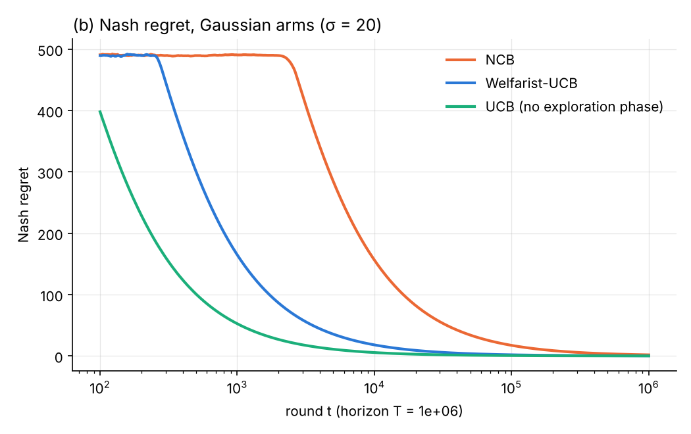
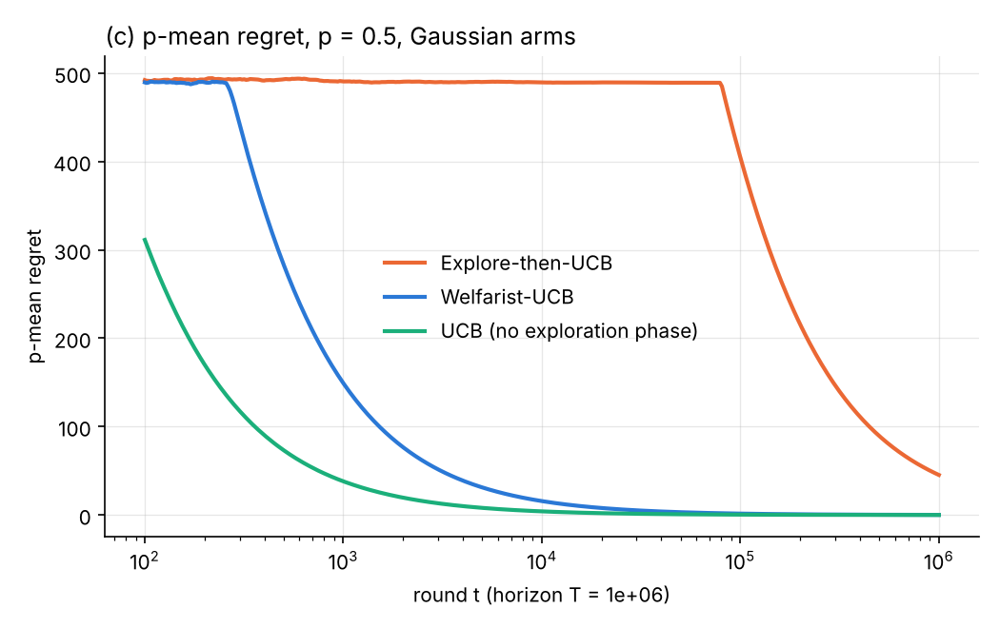
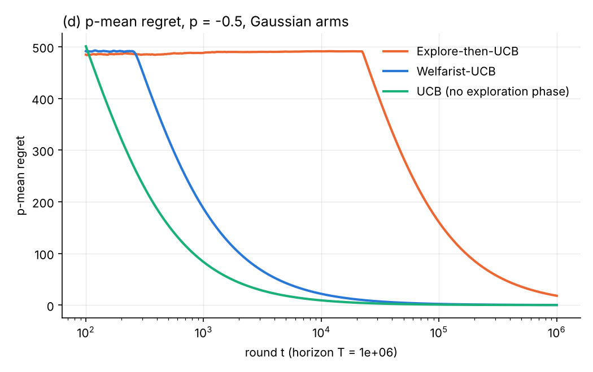
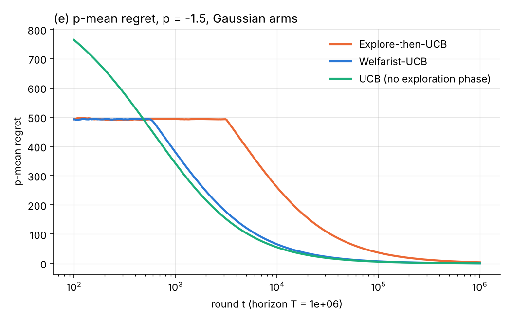

# p-mean welfare in (linear) bandits

Course project: *Contextualizing Fairness: Extending p-Mean Social Welfare to Linear Bandits*.

- **Phase 1 (this code):** reproduce Sarkar, Pandey & Ray Chowdhury, *Revisiting Social Welfare in Bandits:
  UCB is (Nearly) All You Need* ([arXiv:2510.21312](https://arxiv.org/abs/2510.21312),
  [reference code](https://github.com/NP-Hardest/UCBisAllYouNeed)).
- Phase 2: Explore-then-LinUCB for linear contextual bandits.
- Phase 3: evaluation on synthetic data and MovieLens-1M.

## Layout

```
pmlb/
  welfare.py         p-mean, running p-mean and p-mean regret of an expected-reward sequence (setting-agnostic)
  envs.py            Bernoulli / Gaussian MAB instances and the numba reward sampler
  mab/algorithms.py  numba kernels: welfarist_ucb, explore_then_ucb, ncb, ucb
  runner.py          parallel Monte Carlo runner that averages E[reward of the pulled arm] over runs
  plotting.py        regret-curve plots with a fixed colour per algorithm
experiments/
  mab_reproduce.py   Section 5 experiments (a)-(f)
results/
  figures/           expt_a.png ... expt_f.png
  curves/            regret curves on a log grid of rounds (CSV)
  summary.md         final regret and exploration length per run configuration
tests/               pytest
```

Every algorithm kernel has the signature `kernel(*instance_args, seed, out) -> tau`: it writes the expected
reward of the arm it pulls each round into `out` and returns the length of its exploration phase.
`run_trials` and `p_mean_regret_curve` only depend on that contract, so the linear-bandit kernels
for Phase 2 (writing `<x_t, theta*>` into `out`) plug into the same runner, regret and plotting code.

## Running

```bash
pip install -r requirements.txt
python -m pytest
python -m experiments.mab_reproduce          # all of (a)-(f), about 15 minutes on 4 cores
python -m experiments.mab_reproduce c d      # a subset; cached runs in results/cache/ are reused
```

## Setup (taken from the authors' `main.py`)

| | instance | horizon T | p | algorithms |
|---|---|---|---|---|
| (a) | k = 50 Bernoulli, means ~ U[0.005, 1], σ² = 1 | 10⁷ | 0 | NCB, Welfarist-UCB |
| (b) | k = 50 Gaussian, means ~ U[10, 1000], σ = 20 | 10⁶ | 0 | NCB, Welfarist-UCB |
| (c)-(e) | same Gaussian setup, new draw | 10⁶ | 0.5, −0.5, −1.5 | Explore-then-UCB, Welfarist-UCB |
| (f) | same Gaussian setup, new draw | 10⁶ | 1, 0, −1, −2, −5 | Welfarist-UCB |

50 runs each. The arm means are drawn exactly as in the reference code (`np.random.seed(42)` followed by the
four draws in order), so the instances are identical to the paper's. Like the paper, the plots show the
regret of the first t rounds of a single horizon-T run, `μ* − M_p(E[μ_{I_1}], …, E[μ_{I_t}])`, where the
expectation is the average over the 50 runs. We also add plain UCB (Welfarist-UCB's Phase II index without
the exploration phase) to (a)-(e) as an extra baseline.

Algorithm constants follow the reference code, which differ in places from the paper's text:

- **Welfarist-UCB:** confidence width `2√(2σ² log T / n)`; Phase I stops once some arm has a positive LCB and
  `n_i μ̂_i ≥ 200·4·p_a²σ² log T / LCB_i + 2√(2 n_i σ² log T)`; `p_a = 1` for p ≥ −1, else p.
- **Explore-then-UCB (Krishna et al.):** uniform random exploration for
  `16√(T k^p log T / log k)` rounds (p ≥ 0) or `16√(T log T / k^{|p|})` (p < 0), then the bonus `4√(log T / n)`,
  which is not scaled by σ.
- **NCB (Barman et al.):** uniform random exploration until `max_i n_i μ̂_i > 420c² log T` with c = 3.1, then the
  bonus `2c√(2 μ̂_i log T / n_i)`.
- The reference code uses σ² = 1 for Bernoulli rewards (the tight proxy is 1/4).

## Results








Full numbers are in [results/summary.md](results/summary.md). In short:

- **The paper's figures reproduce.** In (a), Nash regret at T = 10⁷ is 0.062 for Welfarist-UCB and 0.225 for NCB,
  the same values as the paper's Figure (a); Welfarist-UCB leaves exploration after about 8.3·10⁵ rounds and
  NCB after about 3.3·10⁶. In (c)-(e), Welfarist-UCB beats Explore-then-UCB at every p (final regret 0.16 vs 45,
  0.22 vs 18, 0.72 vs 3.9), and its curves match the paper's in shape and in where they drop.
- **Regret grows as p decreases (f).** Final regret is 0.13, 0.17, 0.24, 1.3 and 27 for p = 1, 0, −1, −2, −5. For
  p < −1 the stopping rule scales with p², so exploration lengthens from about 275 rounds to 1,010 (p = −2) and
  5,900 (p = −5).
- **Plain UCB is slightly better still on these instances.** Without any exploration phase it reaches lower regret
  than Welfarist-UCB in (a)-(e), for example 0.0033 vs 0.062 in (a). Here every mean is far from 0 relative to
  σ, so UCB's early pulls of bad arms cost little welfare. The point of Welfarist-UCB's Phase I is the worst-case
  guarantee when some arm means are near 0, which these benchmark instances do not test.
