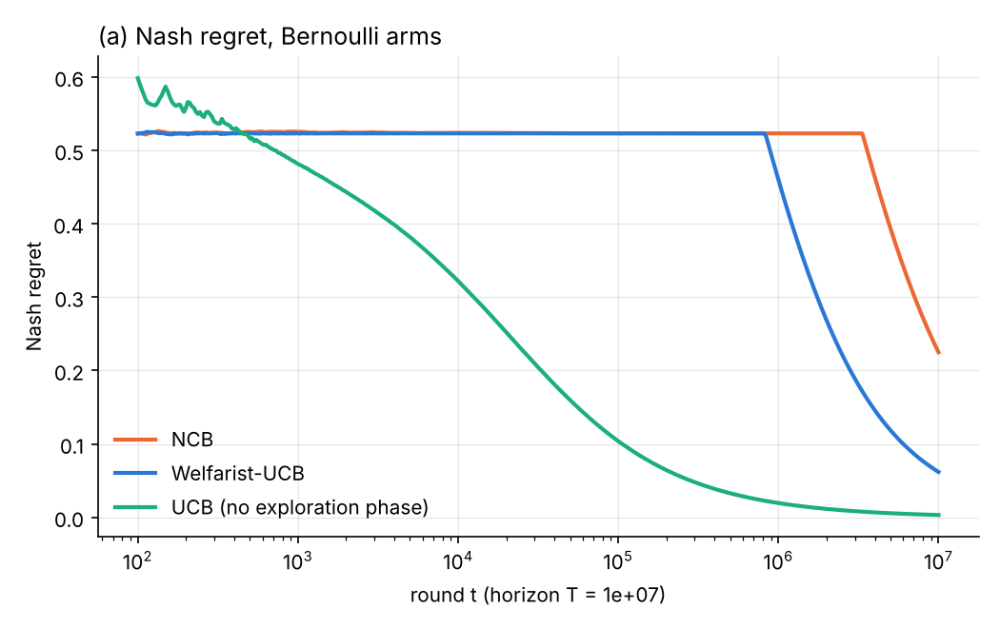
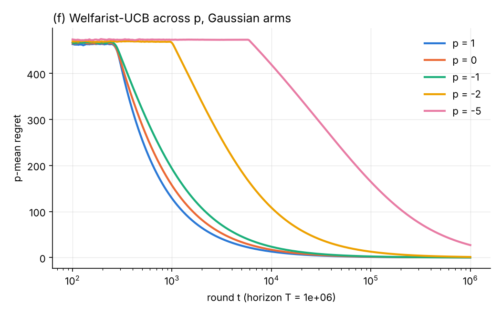
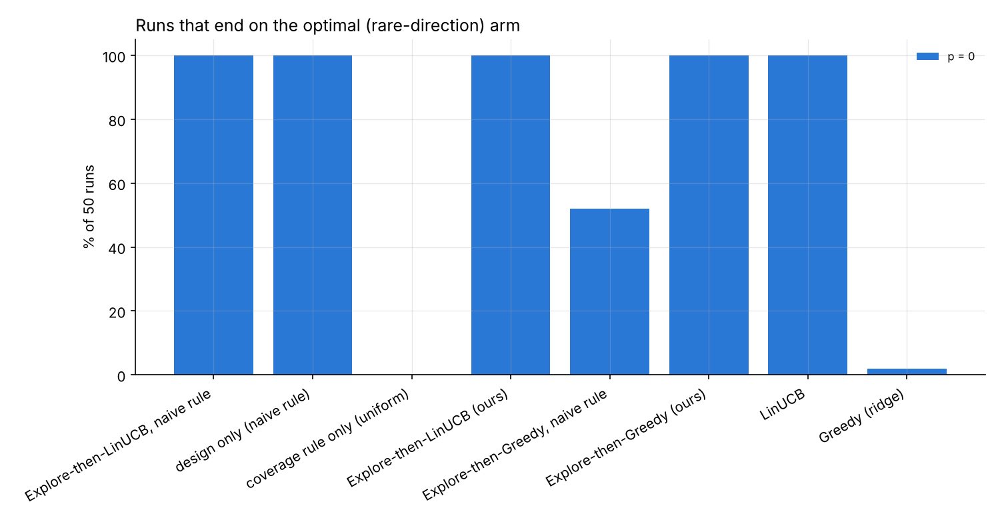
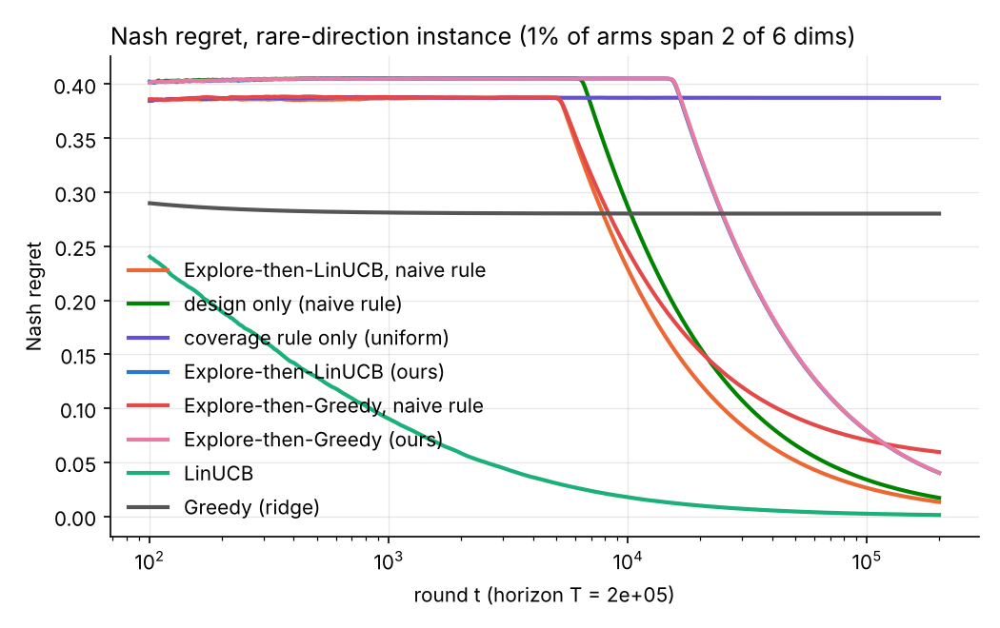
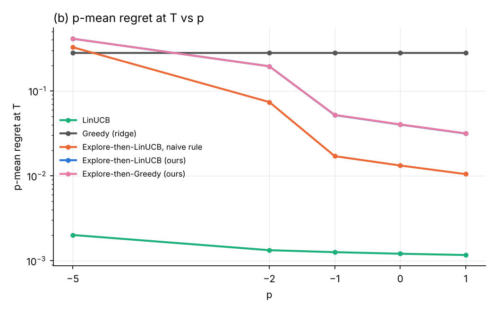
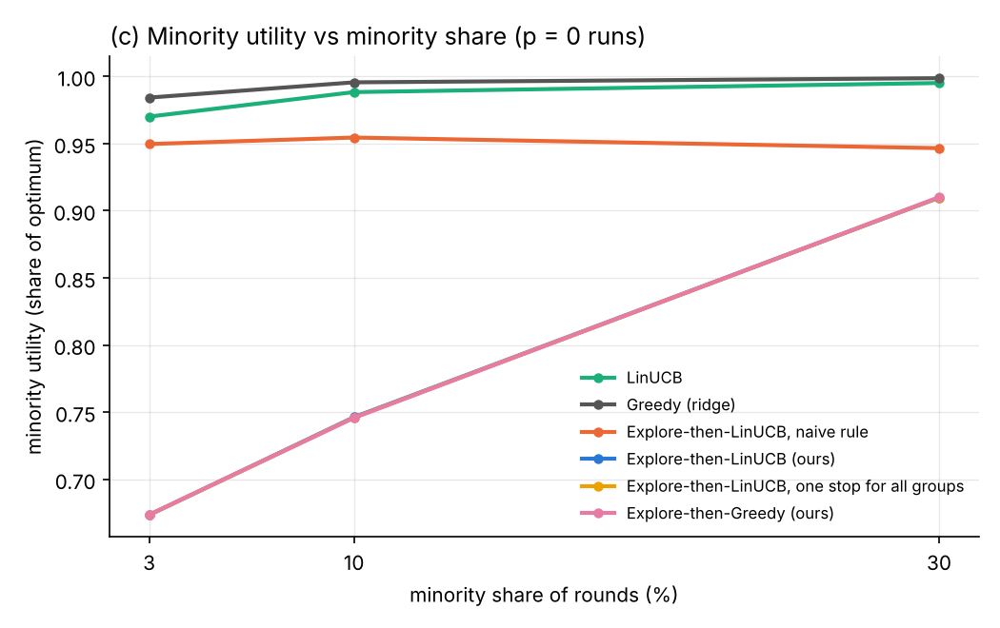
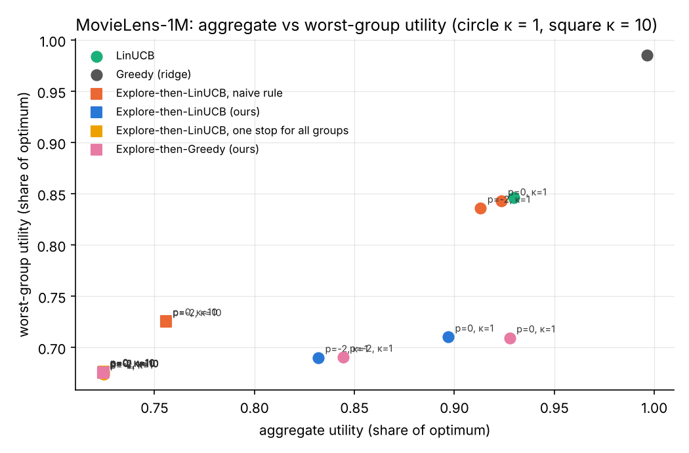
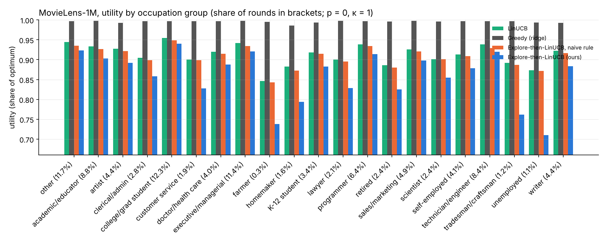

# p-mean welfare in (linear) bandits

Course project (CS6106): *Contextualizing Fairness: Extending p-Mean Social Welfare to Linear Bandits*.
Code: https://github.com/KunjBhesaniya10/pmean-linear-bandits

1. **Reproduction:** reproduce Sarkar, Pandey & Ray Chowdhury, *Revisiting Social Welfare in Bandits: UCB is (Nearly)
   All You Need* ([arXiv:2510.21312](https://arxiv.org/abs/2510.21312),
   [reference code](https://github.com/NP-Hardest/UCBisAllYouNeed)).
2. **Linear extension:** design Explore-then-LinUCB, carrying Welfarist-UCB's exploration phase and stopping rule over to
   linear feature spaces so rare (minority) feature directions are learned before exploitation.
3. **Evaluation:** evaluate it on synthetic linear data and on MovieLens-1M, looking at the trade-off between aggregate
   utility and fairness across user groups for several p.

## Setup

```bash
pip install -r requirements.txt
pip install -e .                       # makes the `pmlb` package (src/pmlb) importable
python -m pytest                       # 40 tests, a few seconds
python scripts/download_movielens.py   # MovieLens-1M into data/ml-1m/ (only needed for the MovieLens experiment)
```

Python 3.10+. The dataset is not in the repository. The script downloads it from
[grouplens.org](https://grouplens.org/datasets/movielens/1m/) (`ml-1m.zip`), or from a
[GitHub CSV mirror](https://github.com/khanhnamle1994/movielens) of the same 1,000,209 ratings if grouplens is
unreachable.

## Running the experiments

| command | output | time (4 cores) |
|---|---|---|
| `python -m experiments.mab_reproduction [a b ... f]` | `results/mab_reproduction/`, `plots/mab_reproduction/` | ~15 min |
| `python -m experiments.linear_stopping_rule` | `results/linear_stopping_rule/`, `plots/linear_stopping_rule/` | ~45 min |
| `python -m experiments.linear_synthetic [a b c]` | `results/linear_synthetic/`, `plots/linear_synthetic/` | ~10 min |
| `python -m experiments.movielens` | `results/movielens/`, `plots/movielens/` | ~5 min |

Averaged runs are cached in `results/cache/` (not committed) and reused; pass `--force` to recompute.
`linear_synthetic b` reuses the `linear_stopping_rule` runs.

## Layout

```
src/pmlb/
  welfare.py            p-mean, p-mean regret, contextual p-mean regret, per-group utilities
  runner.py             parallel Monte Carlo runner (averages E[reward] per round over runs)
  plotting.py           regret curves, bars, trade-off scatter; fixed colour per algorithm
  envs.py               MAB instances and the numba reward sampler
  mab/algorithms.py     MAB kernels: welfarist_ucb, explore_then_ucb, ncb, ucb
  linear/envs.py        linear contextual environments (fixed-arm, rare-direction, two-group)
  linear/algorithms.py  linear kernels: explore_then_linucb (+ variants), linucb, lin_greedy
  data/movielens.py     MovieLens-1M download, loading and semi-synthetic bandit
experiments/            one script per experiment (+ common.py)
scripts/                download_movielens.py
results/<experiment>/   tables (summary.md), CSVs of curves and per-group utilities
plots/<experiment>/     figures
tests/                  pytest
```

Every kernel has the signature `kernel(*args, seed, out) -> tau`: it writes the expected reward of what it plays each
round into `out` and returns its number of exploration rounds. The runner, regret and plotting code only depend on
that contract.

## Welfarist-UCB reproduction (multi-armed bandits)

| | instance | horizon T | p | algorithms |
|---|---|---|---|---|
| (a) | k = 50 Bernoulli, means ~ U[0.005, 1], σ² = 1 | 10⁷ | 0 | NCB, Welfarist-UCB |
| (b) | k = 50 Gaussian, means ~ U[10, 1000], σ = 20 | 10⁶ | 0 | NCB, Welfarist-UCB |
| (c)-(e) | same Gaussian setup, new draw | 10⁶ | 0.5, −0.5, −1.5 | Explore-then-UCB, Welfarist-UCB |
| (f) | same Gaussian setup, new draw | 10⁶ | 1, 0, −1, −2, −5 | Welfarist-UCB |

50 runs each, instances drawn exactly as in the reference code (`np.random.seed(42)`, then the four draws in order).
The plots show `μ* − M_p(E[μ_{I_1}], …, E[μ_{I_t}])` over the first t rounds of one horizon-T run. Plain UCB
(Welfarist-UCB's Phase II without the exploration phase) is added to (a)-(e) as an extra baseline. Algorithm
constants follow the reference code:

- **Welfarist-UCB:** width `2√(2σ² log T / n)`; Phase I stops once some arm has a positive LCB and
  `n_i μ̂_i ≥ 200·4·p_a²σ² log T / LCB_i + 2√(2 n_i σ² log T)`; `p_a = 1` for p ≥ −1, else p.
- **Explore-then-UCB (Krishna et al.):** uniform exploration for `16√(T k^p log T / log k)` rounds (p ≥ 0) or
  `16√(T log T / k^{|p|})` (p < 0), then the bonus `4√(log T / n)`.
- **NCB (Barman et al.):** uniform exploration until `max_i n_i μ̂_i > 420c² log T` with c = 3.1, then the bonus
  `2c√(2 μ̂_i log T / n_i)`.





Other figures: [b](plots/mab_reproduction/expt_b.png), [d](plots/mab_reproduction/expt_d.png), [e](plots/mab_reproduction/expt_e.png).
Numbers: [results/mab_reproduction/summary.md](results/mab_reproduction/summary.md).

- **The paper's figures reproduce.** In (a), Nash regret at T = 10⁷ is 0.062 for Welfarist-UCB and 0.225 for NCB,
  the paper's values. In (c)-(e) Welfarist-UCB beats Explore-then-UCB at every p (0.16 vs 45, 0.22 vs 18, 0.72 vs 3.9).
- **Regret grows as p decreases (f):** 0.13, 0.17, 0.24, 1.3 and 27 for p = 1, 0, −1, −2, −5, because for p < −1
  the stopping rule scales with p² (exploration grows from ~275 rounds to 1,010 and 5,900).
- **Plain UCB does slightly better still** on these instances (e.g. 0.0033 vs 0.062 in (a)). Every mean is far from 0
  relative to σ, so UCB's early pulls of bad arms cost little welfare; Phase I matters for the worst case.

## Explore-then-LinUCB: Welfarist-UCB for linear contextual bandits

**Setting.** Each round t a user u_t arrives with K candidate items; showing item i earns a reward with mean
`⟨x, θ*⟩`, `x = z_u ⊗ y_i` (user features ⊗ item features). A fixed arm set is the special case of one user.
Because the best achievable reward now changes with the context, the p-mean regret compares against the policy
that always shows each round's best candidate: `R_p(T) = M_p(r*_1, …, r*_T) − M_p(E[r_1], …, E[r_T])` (it equals
the paper's regret when there are no contexts). For group fairness we also report each group's **utility**, the
expected reward its members received divided by the best they could have received, and the p-mean of the group
utilities.

**Algorithm** ([src/pmlb/linear/algorithms.py](src/pmlb/linear/algorithms.py)). Ridge regression (λ = 1) and the
radius `β = σ√(2 log T) + ‖θ*‖` for every algorithm.

1. *Phase I sampling.* With probability ½ show a uniformly random candidate (this keeps E[reward] at least half the
   candidates' average, which is what uniform exploration buys the p-mean in the MAB case), otherwise the candidate
   with the largest `‖x‖_{V⁻¹}`, a greedy D-optimal design step that targets the least-explored, typically rare,
   feature directions.
2. *Stopping rule.* Welfarist-UCB's rule simplifies to `LCB_i ≥ 10|p_a|·w_i` for some arm i (w_i its confidence
   width). Under round-robin exploration every arm has the same width, so one arm is enough. With features the widths
   differ by direction, so we require the best lower bound to dominate the width of **every item UCB could still
   pick**: `LCB* = max_a LCB(x_a) > 0` and `LCB* ≥ κ|p_a|·β‖x_a‖_{V⁻¹}` for all a with `UCB(x_a) ≥ LCB*`
   (κ = 10 is the paper's constant).
3. *Groups.* With contexts the rule is tested on each round's candidates and each protected group gets its own
   stopping time: a round explores while any group of its user is uncertified. A variant
   (`explore_then_linucb_global`) keeps everyone exploring until every group is certified.
4. *Phase II:* LinUCB, or greedy exploitation (`explore_then_greedy`), the way deployed recommenders usually run.

The **naive transfer** (`explore_then_linucb_naive`) uses uniform sampling and the paper's best-arm rule on the
current candidates with one global stop. Baselines: **LinUCB** (no exploration phase) and **greedy** ridge regression.

**Does the rule learn rare directions? (`linear_stopping_rule`.)** Fixed-arm instance, d = 6, K = 400, where only 4 arms
(1%) use the 2 rare dimensions and the optimum (0.95) is one of them; the best common arm earns 0.85; σ² = 0.25,
T = 2·10⁵, 50 runs ([table](results/linear_stopping_rule/summary.md)).




- The naive rule stops after ~5,200 rounds, when a *common* arm is certified. With a LinUCB Phase II this is harmless,
  since optimism keeps exploring. With a **greedy Phase II only 52% of runs ever find the rare optimum**; our rule
  explores ~15,600 rounds and **100%** of runs find it, so its final Nash regret is lower (0.040 vs 0.060).
- The coverage rule needs the design step: with uniform sampling it never stops within T (the rare directions get 1%
  of the pulls); D-optimal sampling makes it stop.
- Exploration grows with |p| like in the MAB case: about 3.6× from p ≥ −1 to p = −2, and at p = −5 our rule never
  stops within T ([plot](plots/linear_stopping_rule/exploration_vs_p.png)).
- **LinUCB is best overall** (Nash regret 0.0012 at T), and pure greedy is stuck on a common arm in 98% of runs.

## Evaluation

### Synthetic data ([results/linear_synthetic](results/linear_synthetic))




- **(a) benign fixed-arm instance** (K = 50, d = 6, means 0.53-0.97) and **(b) the rare-direction instance**: the
  ranking is the same at every p: LinUCB < naive Explore-then-LinUCB < ours ≪ greedy (greedy gets stuck when the
  arm set never changes). Every exploration phase costs regret, and the cost grows quickly for p ≤ −2
  ([a](plots/linear_synthetic/a_benign_regret_vs_p.png), [b](plots/linear_synthetic/b_rare_direction_regret_vs_p.png)).
- **(c) two groups**, where the minority owns a feature block that is non-zero only in its own rounds and prefers
  different items. LinUCB and greedy keep minority utility at 0.97-1.0 because changing candidate sets give them
  free exploration. Certifying the minority to the same precision takes ~1/share times longer, and whoever explores
  pays for it: with per-group stopping the majority exploits early (utility 0.955) but the **minority drops to
  0.75 at a 10% share and 0.67 at 3%** (it never gets certified within T); with one global stop everyone explores
  and aggregate utility falls to 0.70 (10%) and 0.62 (3%). The naive rule stops on majority contexts and keeps the
  minority at ~0.95. [Trade-off plot](plots/linear_synthetic/c_tradeoff.png).

### MovieLens-1M ([results/movielens](results/movielens))

Semi-synthetic bandit built from MovieLens-1M ([src/pmlb/data/movielens.py](src/pmlb/data/movielens.py)): reward =
the user likes the movie (rating ≥ 4); user features are one-hot gender, age band and occupation (30), so each group
owns its own coordinates and small groups such as farmers (0.3% of rounds) are rare directions; item features are a
bias, the movie's like rate and a rank-4 SVD embedding (6); θ* (180) is the ridge fit of like ~ z ⊗ y on all
ratings of the 300 most rated movies, so the environment is exactly linear with like probabilities in (0.03, 0.99).
Users arrive uniformly at random, with 20 random candidate movies per round; T = 50,000, 20 runs.




| algorithm | κ | exploration rounds | aggregate utility | Nash regret | worst occupation | group welfare M₋₂ |
|---|---|---|---|---|---|---|
| Greedy | - | 0 | **0.996** | **0.003** | 0.986 (homemaker) | **0.996** |
| LinUCB | - | 0 | 0.930 | 0.072 | 0.846 (farmer) | 0.914 |
| Explore-then-LinUCB, naive | 1 | 2,943 | 0.923 | 0.076 | 0.843 (farmer) | 0.908 |
| Explore-then-LinUCB (ours) | 1 | 12,388 | 0.897 | 0.102 | 0.710 (unemployed) | 0.861 |
| Explore-then-Greedy (ours) | 1 | 12,599 | 0.928 | 0.076 | 0.709 (unemployed) | 0.887 |
| any explore-then | 10 | 50,000 | 0.72-0.76 | 0.22-0.26 | 0.68-0.73 | 0.73-0.76 |

(p = 0; the full table with p = −2 and the worst gender and age groups is in
[summary.md](results/movielens/summary.md), per-group utilities in
[group_utilities.csv](results/movielens/group_utilities.csv).)

- With the paper's κ = 10 no explore-then algorithm leaves Phase I within 50,000 rounds (d = 180), so we also report
  κ = 1 (stop once the best lower bound exceeds the plausible items' widths).
- **Greedy is best on every measure**, including the worst group: random users and candidate sets make the data
  diverse enough that exploiting alone learns every group's coordinates, as in Bastani et al. (2021) and
  Raghavan et al. (2018).
- **LinUCB's exploration falls on the small groups:** its utility is lowest for farmers (0.85), age 56+ and
  homemakers, whose coordinates stay uncertain longest, so they keep getting exploratory recommendations.
- **Per-group stopping makes this sharper:** large groups exploit after a few thousand rounds while small groups
  (unemployed 1.1%, farmer 0.3%, retired 2.4%) keep exploring, so worst-group utility falls to 0.69-0.71. Lowering p
  to −2 lengthens exploration and lowers both aggregate and worst-group utility.

## Takeaways

1. The exploration phase transfers to linear bandits, but the stopping rule has to look at *all plausible* items, not
   just the best one, and it needs design-based sampling to be feasible when some directions are rare. That version
   reliably learns the rare optimum before exploiting, which is what makes a greedy Phase II safe (100% vs 52%).
2. As with plain UCB in the reproduction, optimism without an exploration phase (LinUCB) has the lowest p-mean regret on every
   synthetic instance and every p we tried.
3. Learning a minority's own feature directions to the same precision costs about 1/(its share) times more rounds.
   Whoever explores pays for it: the minority itself with per-group stopping, everyone with a global stop. With
   diverse contexts (MovieLens) greedy already learns every group and is the fairest and most efficient policy.

## References

- A. Sarkar, A. Pandey, S. Ray Chowdhury. Revisiting Social Welfare in Bandits: UCB is (Nearly) All You Need. arXiv:2510.21312, 2025.
- A. Krishna, P. G. John, A. Barik, V. Y. F. Tan. p-Mean Regret for Stochastic Bandits. AAAI 2025.
- S. Barman, A. Khan, A. Maiti, A. Sawarni. Fairness and Welfare Quantification for Regret in Multi-Armed Bandits. AAAI 2023.
- Y. Abbasi-Yadkori, D. Pál, C. Szepesvári. Improved Algorithms for Linear Stochastic Bandits. NeurIPS 2011.
- L. Li, W. Chu, J. Langford, R. Schapire. A Contextual-Bandit Approach to Personalized News Article Recommendation. WWW 2010.
- H. Bastani, M. Bayati, K. Khosravi. Mostly Exploration-Free Algorithms for Contextual Bandits. Management Science, 2021.
- M. Raghavan, A. Slivkins, J. Wortman Vaughan, Z. S. Wu. The Externalities of Exploration and How Data Diversity Helps Exploitation. COLT 2018.
- F. M. Harper, J. A. Konstan. The MovieLens Datasets: History and Context. ACM TiiS, 2015.
