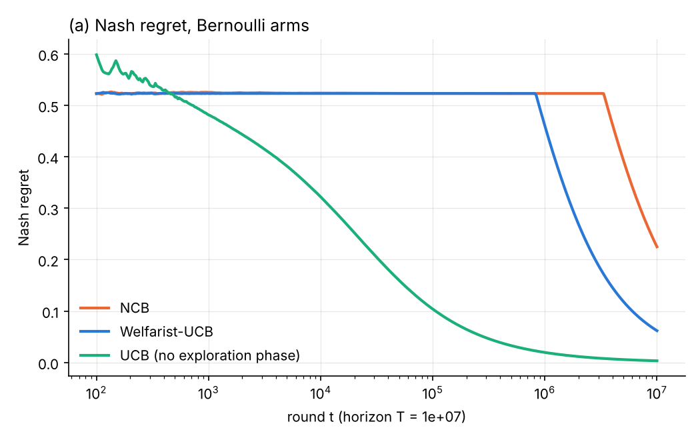
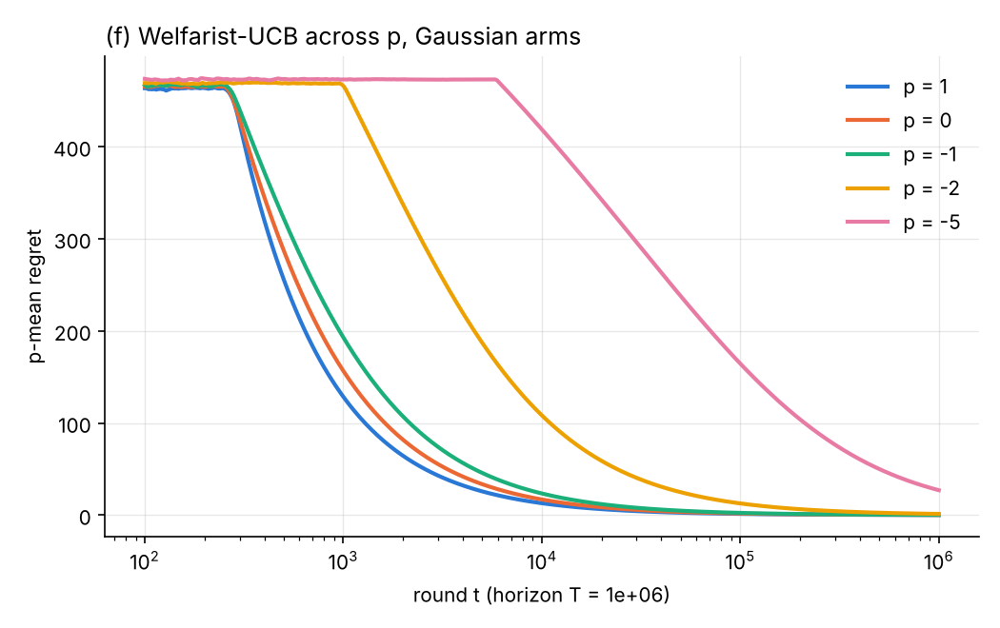
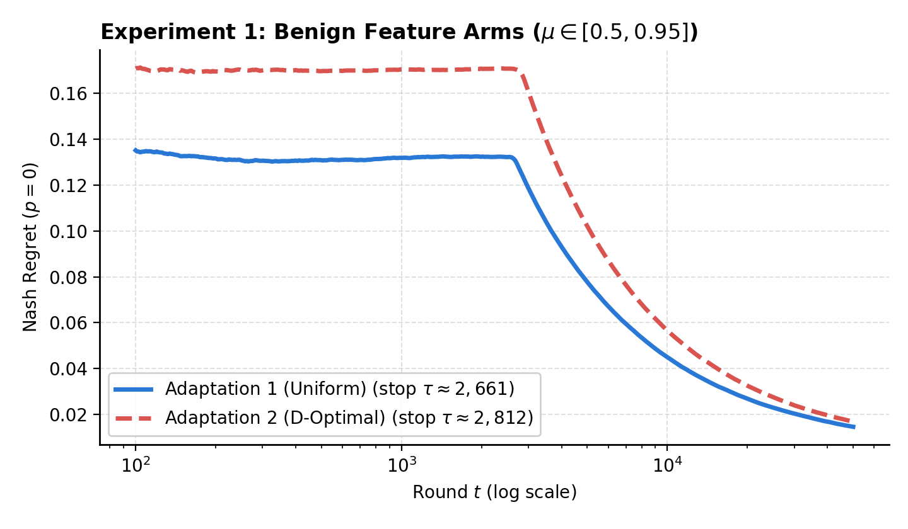
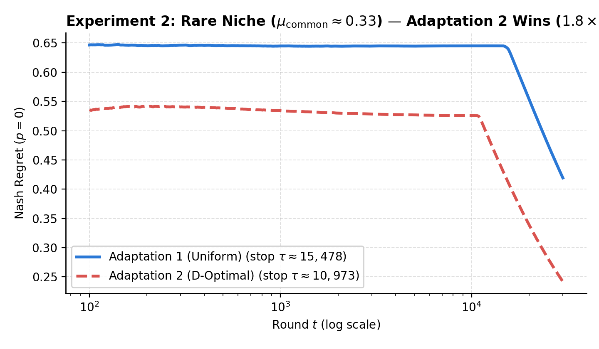
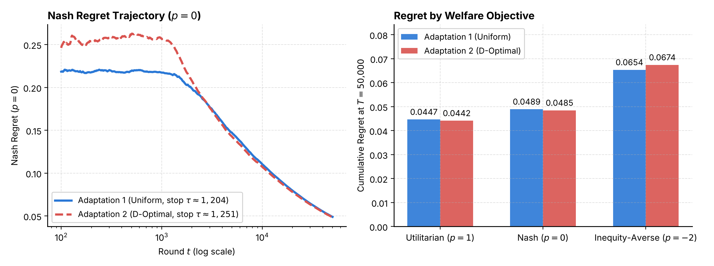
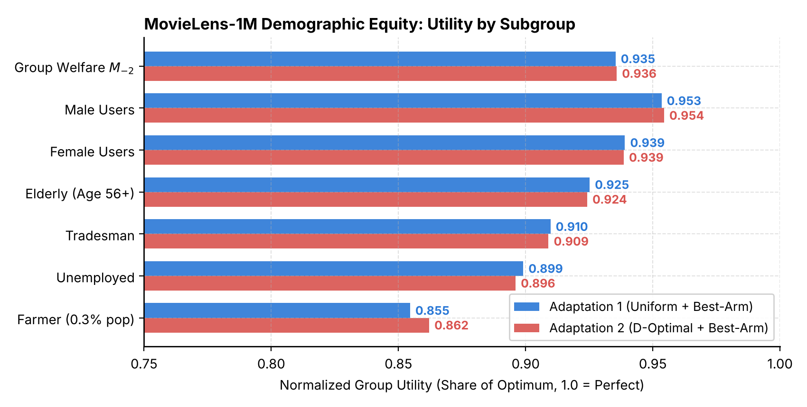

**Code:** <https://github.com/KunjBhesaniya10/pmean-linear-bandits>

# 1. Introduction

In a normal multi-armed bandit the goal is to maximise total reward, i.e. minimise the average regret. When every round is a different person (a patient in a trial, a user getting a recommendation) this objective does not care who gets a bad round. An algorithm can give a few people very bad arms early on and still have small average regret.

p-mean social welfare fixes this by replacing the arithmetic mean of the per-round expected rewards with the power mean $M_p$. With $p = 1$ we get back the usual utilitarian objective, $p = 0$ gives the geometric mean (Nash social welfare), and $p \to -\infty$ only looks at the worst-off round (Rawlsian / egalitarian). So one parameter covers the whole range of fairness notions.

Our base paper is Sarkar, Pandey and Ray Chowdhury (2025), *"Revisiting Social Welfare in Bandits: UCB is (Nearly) All You Need"*. They show that a very simple algorithm, Welfarist-UCB (uniform exploration with a data-adaptive stopping rule, then plain UCB), gets near-optimal p-mean regret for every $p$, with weaker assumptions than earlier work (Barman et al. 2023, Krishna et al. 2025).

That paper is for plain multi-armed bandits, where arms have no features. In most real uses like recommendation, each option comes with side information and the set of options changes with the user. So in this project we did two things:

1. **Reproduced** the Welfarist-UCB experiments (a)–(f) of the base paper from scratch.
2. **Tried to extend** the explore-then-UCB idea to *contextual* linear bandits, where the candidate set changes every round, and compared two ways of doing the exploration phase on synthetic data and on MovieLens-1M.

While we were working on this, the same authors put out FairLinBandit (Sarkar et al. 2026), which extends Welfarist-UCB to linear bandits with a *fixed* arm set. Their method needs a John ellipsoid and a D-optimal design computed over the whole arm set before the start. That cannot be done when the candidate set is new every round, which is the case we look at. So our work should be read as an empirical study of the contextual case, not as a new algorithm with guarantees. We do not have a regret bound for our adaptations.

# 2. Problem Setup

## 2.1 Multi-armed bandit with p-mean regret

There are $k$ arms with unknown means $\mu_1, \dots, \mu_k \ge 0$ and $\sigma^2$-sub-Gaussian rewards. Let $\mu^\star = \max_i \mu_i$. At round $t = 1..T$ the learner pulls $I_t$ using only past observations. The p-mean regret is

$$R^p_T = \mu^\star - \Big(\frac{1}{T}\sum_{t=1}^T \mathbb{E}[\mu_{I_t}]^p\Big)^{1/p}, \qquad NR_T = \mu^\star - \Big(\prod_{t=1}^T \mathbb{E}[\mu_{I_t}]\Big)^{1/T}\ (p=0).$$

$R^p_T$ increases as $p$ decreases, so smaller $p$ is a harder (fairer) objective. For $p \le 0$ one round with expected reward close to zero can push the welfare towards zero, and this is exactly why plain UCB has no guarantee here.

## 2.2 Linear contextual bandit

In round $t$ a user $u_t$ arrives and is shown a candidate set $\mathcal{C}_t$ of $K$ items. The feature of item $i$ for user $u$ is $x = z_u \otimes y_i$ (Kronecker product of user and item features) and the expected reward is $\langle x, \theta^\star \rangle$ for an unknown $\theta^\star \in \mathbb{R}^d$. Since the best reward now changes every round, we measure regret against the per-round optimum:

$$R^p_T = M_p(r^\star_1, \dots, r^\star_T) - M_p(\mathbb{E}[r_1], \dots, \mathbb{E}[r_T]), \qquad r^\star_t = \max_{a \in \mathcal{C}_t} \langle x_a, \theta^\star\rangle .$$

When there is one user and a fixed arm set this is the same as the normal linear bandit p-mean regret. On MovieLens we also report a **normalised group utility** for each demographic group $g$: the sum of $\mathbb{E}[r_t]$ over rounds where a member of $g$ arrived, divided by the same sum for the optimal policy (1.0 is perfect). The group welfare is $M_{-2}$ of these 30 group utilities.

# 3. Approach

## 3.1 Welfarist-UCB (base paper)

- **Phase I:** in every block of $k$ rounds pull the arms in a fresh random permutation. Each round has expected reward at least $\mu^\star/k$, so welfare never collapses.
- **Stopping rule:** with $w_i = 2\sqrt{2\sigma^2 \log T / n_i}$, stop the first time some arm has $\hat\mu_i > w_i$ and $n_i > 192\, p_a^2 \sigma^2 \log T / (\hat\mu_i - w_i)^2$, where $p_a = 1$ for $p \ge -1$ and $p_a = p$ otherwise. Basically: the best arm's LCB must be positive and large compared to its own width. For $p < -1$ exploration grows like $p^2$.
- **Phase II:** standard UCB with index $\hat\mu_i + w_i$.

Baselines from the paper: NCB (Barman et al. 2023) for Nash regret and Explore-then-UCB (Krishna et al. 2025), which explores for a fixed $p$-dependent number of rounds.

## 3.2 Why the direct linear version is not obvious

FairLinBandit handles the linear case by mixing (i) samples from a distribution centred at the John ellipsoid of the arm set, which guarantees a reward floor of about $\mu^\star/(d+1)$, and (ii) a D-optimal design, which makes all directions equally well estimated. Both are computed once over the fixed arm set. In our setting the arm set $\mathcal{C}_t$ depends on the user and is new each round, so neither object exists in advance. Also, uniform sampling over arms is no longer uniform over *feature directions*: if only a few items use some coordinate, that direction is rarely seen.

So the question we tried to answer was: how should Phase I and the stopping rule look when we cannot precompute any geometry?

## 3.3 Adaptation 1: uniform transfer (Welfarist-UCB unchanged)

This is the most direct copy of Welfarist-UCB.

- **Phase I:** pick $a_t \sim \text{Uniform}(\mathcal{C}_t)$.
- **Stopping:** using the ridge estimate $\hat\theta_t$ and design matrix $V_t = \lambda I + \sum_s x_s x_s^\top$, stop as soon as some candidate satisfies
  $$\text{LCB}(x_a) = \langle x_a, \hat\theta_t\rangle - \beta \|x_a\|_{V_t^{-1}} > 0 \quad\text{and}\quad \text{LCB}(x_a) \ge \kappa\, |p_a|\, \beta\, \|x_a\|_{V_t^{-1}} .$$
  The width $\sqrt{1/n_i}$ just becomes $\beta\|x_a\|_{V_t^{-1}}$. We use $\beta = \sigma\sqrt{2\log T} + \sqrt{\lambda} S$ (the Abbasi-Yadkori radius without the $d \log t$ term, as most practical LinUCB code does; with that term nothing ever stops in our horizons).
- **Phase II:** LinUCB, warm-started with $V_\tau$ and $\hat\theta_\tau$ from Phase I.

## 3.4 Adaptation 2: 50/50 with greedy D-optimal steps

Same stopping rule and same Phase II, only Phase I changes. In each exploration round, with probability 1/2 we take a uniform candidate (to keep some reward floor like in Welfarist-UCB), and with probability 1/2 we take

$$a_t = \arg\max_{a \in \mathcal{C}_t} \|x_a\|_{V_t^{-1}},$$

the candidate whose prediction we are least sure about. Adding this $x_a$ gives the largest increase of $\det V_t$, so it is a greedy one-step D-optimal design over whatever candidates we have right now. The idea is the same as the D-optimal half of FairLinBandit, but it needs nothing precomputed. The intuition is that the most uncertain candidates are usually the ones lying in rare feature directions, so the algorithm learns those directions on purpose rather than waiting to hit them by chance.

The cost is that the max-width candidate can have low reward, so in easy instances where uniform sampling already covers everything, the extra steps are just wasted rounds.

# 4. Implementation

Everything is written from scratch in Python (package `pmlb`), with the inner loops compiled by Numba (`@njit`), since experiment (a) alone is $50 \times 10^7$ rounds per algorithm.

- `src/pmlb/welfare.py`: p-mean, running p-mean, p-mean regret curves, contextual regret and group utilities.
- `src/pmlb/mab/algorithms.py`: Welfarist-UCB, NCB and Explore-then-UCB kernels. Constants follow the authors' public code (e.g. the stopping constant is $800 p_a^2 \sigma^2 \log T$ in their code, vs 192 in the paper text).
- `src/pmlb/linear/algorithms.py`: the two adaptations and LinUCB. $V_t^{-1}$ is kept with $O(d^2)$ Sherman–Morrison updates instead of re-inverting. Widths skip zero coordinates, which matters for MovieLens where $x$ is sparse ($d = 180$).
- `src/pmlb/linear/lin_nash.py`, `fair_lin_bandit.py`: our implementations of LinNash (Sawarni et al. 2023) and FairLinUCB (Sarkar et al. 2026) for fixed arm sets. They are in the repo and tested, but they are not in the final experiments because they cannot run when the candidate set changes per round (see Section 6).
- `src/pmlb/data/movielens.py`: builds the semi-synthetic MovieLens bandit (below).
- `experiments/`: one script per set of results; `scripts/run_all_experiments.py` runs everything.
- `tests/`: 44 pytest tests (p-mean identities and monotonicity in $p$, Sherman–Morrison against direct inversion, kernels only pick real candidates and are reproducible under a seed, exploration grows as $p$ decreases, MovieLens group encoding). All pass in about 20 s.

All runs are seeded and we checked that rerunning gives exactly the same numbers.

**MovieLens-1M environment.** Reward is "user likes the movie" (rating $\ge 4$), a Bernoulli reward. User features $z$ (30-dim) are one-hot gender (2), age band (7) and occupation (21), so every demographic group has its own coordinates and small groups (e.g. 17 farmers, 0.3% of rounds) are rare feature directions. Item features $y$ (6-dim) are a bias, the movie's like rate, and a rank-4 SVD embedding of the centred like matrix. $\theta^\star$ (180-dim) is the ridge fit of like $\sim z_u \otimes y_i$ over all ratings of the 300 most-rated movies, so the environment is exactly linear and its expected rewards are the fitted like probabilities (all inside (0,1), the code checks this). Each round a uniformly random user arrives with 20 random candidate movies, $T = 50{,}000$, 20 runs.

# 5. Results

## 5.1 Reproduction of Welfarist-UCB (k = 50, 50 runs each)

Instances are drawn exactly like the authors' code (`np.random.seed(42)`), so the arm means are the same as theirs.

| Expt | Setting | Algorithm | Regret at T | Phase I length $\tau$ |
|---|---|---|---|---|
| (a) | Bernoulli, $p=0$, $T=10^7$ | NCB | 0.225 | 3,349,088 |
| | | **Welfarist-UCB** | **0.062** | 828,816 |
| (b) | Gaussian $\sigma=20$, $p=0$, $T=10^6$ | NCB | 1.75 | 2,487 |
| | | **Welfarist-UCB** | **0.182** | 266 |
| (c) | Gaussian, $p=0.5$ | Explore-then-UCB | 45.3 | 79,955 |
| | | **Welfarist-UCB** | **0.16** | 266 |
| (d) | Gaussian, $p=-0.5$ | Explore-then-UCB | 18.1 | 22,365 |
| | | **Welfarist-UCB** | **0.22** | 266 |
| (e) | Gaussian, $p=-1.5$ | Explore-then-UCB | 3.85 | 3,163 |
| | | **Welfarist-UCB** | **0.72** | 592 |

{width=72%}

Our numbers match the paper's figures: Welfarist-UCB beats NCB by about 4x in (a) and 10x in (b), and beats Explore-then-UCB at all three $p$, by two orders of magnitude for $p \ge -0.5$. The gap gets smaller at $p = -1.5$ because the stopping rule now has $p_a^2 = 2.25$ and explores longer.

**Effect of $p$ (experiment f).**

| $p$ | 1 | 0 | −1 | −2 | −5 |
|---|---|---|---|---|---|
| Regret at $T$ | 0.13 | 0.17 | 0.24 | 1.29 | 27.0 |
| $\tau$ | 276 | 273 | 275 | 1,010 | 5,922 |

For $p \ge -1$ the stopping rule does not depend on $p$, so $\tau$ is basically constant. Below $-1$ it scales with $p^2$ (3.7x at $p=-2$, 21x at $p=-5$), which is the "no free fairness" cost the paper predicts.

{width=72%}

## 5.2 Synthetic linear experiments (Nash regret, $p = 0$, $\kappa = 10$, 15 runs)

**Experiment 1, benign arms** ($d = 6$, $K = 50$, $T = 50{,}000$). Features and $\theta^\star$ are positive and random, so every direction is common; means lie in $[0.65, 0.96]$.

| | $\tau$ | Nash regret at $t = 10^4$ | Nash regret at $T$ |
|---|---|---|---|
| Adaptation 1 (uniform) | 2,661 | 0.045 | **0.0146** |
| Adaptation 2 (50/50 D-opt) | 2,812 | 0.057 | 0.0169 |

Both stop early and the regret goes to near zero after the switch to LinUCB. Adaptation 1 is slightly better here. This is what we expected: when all directions are already covered by uniform sampling, the max-width steps just pick lower-reward arms during Phase I, which shows up as the higher plateau of Adaptation 2 before $\tau$.

{width=72%}

**Experiment 2, rare direction** ($d = 6$, $K = 100$, $T = 30{,}000$). 98 "common" arms only use the first four coordinates and have mediocre means (0.21 to 0.33). Only two arms have weight on the fifth coordinate, and the optimum (0.95) is one of them.

| | $\tau$ | Nash regret at $t = 10^4$ | Nash regret at $T$ |
|---|---|---|---|
| Adaptation 1 (uniform) | 15,478 | 0.645 | 0.419 |
| Adaptation 2 (50/50 D-opt) | **10,973** | **0.526** | **0.242** |

Here Adaptation 2 has about 1.7x lower final regret and stops about 4,500 rounds earlier. With uniform sampling the rare direction is seen in only 2 of every 100 pulls, so no arm becomes certified for a long time (the common arms are too low for the LCB condition with $\kappa = 10$). The max-width steps go straight to the rare direction, so the optimum's LCB grows faster and the rule fires earlier.

{width=72%}

## 5.3 MovieLens-1M ($d = 180$, $K = 20$, $T = 50{,}000$, $\kappa = 1$, 20 runs)

With the paper's $\kappa = 10$ the stopping rule did not fire within 50,000 rounds on MovieLens ($d = 180$ is much bigger than the synthetic $d = 6$), so here we use $\kappa = 1$.

| | $p$ used in rule | $\tau$ | Aggregate utility | Regret $p=1$ | Regret $p=0$ | Regret $p=-2$ | Group welfare $M_{-2}$ |
|---|---|---|---|---|---|---|---|
| Adaptation 1 | 0 | 1,205 | 0.9494 | 0.0447 | 0.0489 | 0.0650 | 0.9353 |
| Adaptation 2 | 0 | 1,251 | 0.9500 | 0.0442 | 0.0485 | 0.0633 | 0.9358 |
| Adaptation 1 | −2 | 2,708 | 0.9451 | 0.0485 | 0.0527 | 0.0654 | 0.9318 |
| Adaptation 2 | −2 | 2,681 | 0.9465 | 0.0473 | 0.0521 | 0.0674 | 0.9329 |

{width=95%}

Both adaptations leave Phase I after a little over 1,000 rounds and then behave almost the same under LinUCB. Adaptation 2 is a tiny bit better on most numbers when run with $p = 0$, and a tiny bit worse on the $p = -2$ regret when run with $p = -2$. Honestly these differences (third decimal) are small and we did not run significance tests, so we read this as "about the same".

**Groups.** The smallest group, farmers (0.33% of rounds, about 165 rounds per run), gets 0.862 with Adaptation 2 vs 0.855 with Adaptation 1, and is the worst-off group under both. But across all 30 groups Adaptation 2 is higher on 18 and lower on 12, so it is not a uniform improvement. The worst-off groups for both are small occupations (farmer, unemployed, homemaker, tradesman) and older users, i.e. exactly the rare feature directions.

{width=80%}

## 5.4 Summary

- The reproduction works and matches the paper.
- In the contextual linear case, a direct transfer of Welfarist-UCB (Adaptation 1) is already fine when every feature direction is common. Adding greedy D-optimal steps (Adaptation 2) costs a bit there.
- When the good arm sits in a rare direction, Adaptation 2 learns it faster and gets about 1.7x lower Nash regret.
- On MovieLens both are almost tied; the small groups are worst-off under both.

# 6. Challenges and Learnings

- **Concurrent paper.** Midway through, we found FairLinBandit (Sarkar et al. 2026) by the base paper's authors, which already does the fixed-arm linear case with proofs. We had to rethink what we can actually claim. We decided to keep our goal (p-mean in the contextual setting) and use the paper as related work instead of switching to it, and to be clear that our part is an empirical study without guarantees.
- **Baselines.** At first we also compared against plain UCB / LinUCB, which often had lower p-mean regret on the paper's instances (all arm means are far from zero, so the worst case that Welfarist-UCB protects against never happens). The base paper does not compare with plain UCB, so we removed it and kept comparisons that match the paper's structure. We learned to be careful about what the baseline is supposed to show.
- **LinNash and FairLinUCB need a fixed arm set.** We implemented both, but their design/ellipsoid steps are computed once over the arm set, so they cannot be run on the contextual experiments without changing them into something else. We left them out of the final comparison rather than adapt them ourselves and call it their method.
- **Constants.** The paper-text constant (192) and the reference code constant (800) differ; we followed the code since we were reproducing their figures. $\kappa = 10$ never stops on MovieLens, so we had to use $\kappa = 1$ there, which is a tuning choice, not something we can justify theoretically.
- **Is the 50/50 change justified?** Before the presentation, our first draft results showed the plain transfer beating the 50/50 version, and we did not want to present a change that looked ad hoc. The rare-direction experiment is what justifies it: the extra steps only pay off when some direction is rare. On benign instances they cost a little. We think this trade-off is the honest result.
- **Practical stuff.** Long horizons ($10^7$) needed Numba; the official MovieLens site was down / blocked for us, so the download script falls back to a GitHub mirror and checks the dataset size (1,000,209 ratings, 6,040 users).
- **Open problem.** A regret bound for p-mean welfare in contextual linear bandits with arbitrary changing candidate sets is still open as far as we know.

# 7. Team Contributions

*[To be filled in by the team: who did what, e.g. paper reading and reproduction, linear adaptations, MovieLens pipeline, experiments, slides, report.]*

# 8. References

1. D. Sarkar, N. Pandey, S. Ray Chowdhury. *Revisiting Social Welfare in Bandits: UCB is (Nearly) All You Need.* arXiv:2510.21312, 2025. Code: github.com/NP-Hardest/UCBisAllYouNeed.
2. D. Sarkar, N. Pandey, S. Ray Chowdhury. *Improved Algorithms for Nash Welfare in Linear Bandits.* ICML 2026, arXiv:2601.22969.
3. S. Barman, A. Khan, A. Maiti, A. Sawarni. *Fairness and Welfare Quantification for Regret in Multi-Armed Bandits.* AAAI 2023.
4. A. Krishna, P. G. John, A. Barik, V. Y. F. Tan. *p-Mean Regret for Stochastic Bandits.* AAAI 2025.
5. A. Sawarni, S. Pal, S. Barman. *Nash Regret Guarantees for Linear Bandits.* NeurIPS 2023.
6. Y. Abbasi-Yadkori, D. Pál, Cs. Szepesvári. *Improved Algorithms for Linear Stochastic Bandits.* NeurIPS 2011.
7. L. Li, W. Chu, J. Langford, R. E. Schapire. *A Contextual-Bandit Approach to Personalized News Article Recommendation.* WWW 2010.
8. T. Lattimore, Cs. Szepesvári. *Bandit Algorithms.* Cambridge University Press, 2020 (Ch. 21–22, optimal design).
9. H. Moulin. *Fair Division and Collective Welfare.* MIT Press, 2004.
10. F. M. Harper, J. A. Konstan. *The MovieLens Datasets: History and Context.* ACM TiiS, 2015.

# Appendix A: AI Prompts Used

We used Claude (Anthropic) as an assistant, through a project workspace connected to our GitHub repo. Most of our prompts were short follow-up questions, so as the TAs allowed, we have merged related prompts into one prompt per task and cleaned up typos. Each one keeps what we actually asked; nothing here is a request we did not make. Dates are from the chat history.

## A.1 Research and planning

**1. Understanding the project and finding the base paper (24–26 Oct).**
"we are starting with this project, summarize the plan first. which paper actually implements p-mean welfare in bandits? our base should be either the Barman et al. paper or the Sarkar et al. one, find the exact papers and write down their algorithm, stopping rule, regret bounds and the experiments we need to reproduce. the paper text doesn't give the horizon T so check their code for it."

**2. Choosing the dataset (26 Oct).**
"our base paper is Sarkar et al. what dataset should we use? is MovieLens meant for the linear bandit part or for the reproduction? so the plan is: reproduce the results first, then extend to the linear setting, then test on both synthetic and real data. also is 1M enough or do we need a bigger MovieLens version?"

**3. Positioning against prior work (27–28 Oct).**
"our prof said linear bandits have only been explored for Nash regret, so cite that work (LinNash, Sawarni et al.). let's be honest here, if this extension was easy someone would have done it already, we are not discovering something new in a short project, this is our independent study of extending it to p-means and it may not work. word the README like that, no novelty claims."

**4. Reviewing the FairLinBandit paper (28–29 Oct).** *[we uploaded arXiv:2601.22969]*
"review this paper and tell me if it is relevant to our extension. don't change any of our work and don't add it as a baseline, our project goal stays the same. i just want to know how similar their algorithm is to what we did, step by step, and whether it does better. don't assume or speculate, what does it mean that it only handles a fixed arm set, isn't it for general linear bandits? and explain the difference between contextual bandits and linear bandits."

## A.2 Code

**5. Reproduction code (26 Oct).**
"implement Welfarist-UCB, NCB and Explore-then-UCB from scratch and reproduce experiments (a)–(f) with the same instances as the authors' code, 50 runs each. we are implementing Welfarist-UCB right? push to main with a short commit and no co-author line."

**6. Linear extension and repo structure (27 Oct).**
"now do the linear part and the experiments, keep a proper directory structure for src, results, plots. don't use phase names in the code or folders, those were just for planning. explain how exactly we go from Welfarist-UCB to LinUCB, what we change in it and which reference papers each part comes from. also what is njit(cache=True)?"

**7. Fixing the baselines (28 Oct).**
"what is plain LinUCB, is it built for average regret? we are measuring Nash/p-mean regret so we have to check the fairness of both. why have they introduced Welfarist-UCB if plain UCB does better? and who said to add plain UCB? the paper doesn't compare with it so we shouldn't either. remove it, and if we remove it what do we compare the linear results with? implement LinNash from the paper I uploaded, not from memory."

**8. Naming the variants (29 Oct).**
"who told you to make 2 algorithms? what is the naive transfer exactly? ok keep it but label it as Welfarist-UCB unchanged everywhere, plots, tables and README."

## A.3 Testing and checking results

**9. Tests and data checks (26–27 Oct).**
"why is there a test directory and a test plan, what do they check? i will clone the repo and review the code myself before we go further. the official MovieLens site is down for me, which file should I download, and how do we know the mirror is the same data?"

**10. Sanity-checking results (27 Oct).**
"are all the results as expected? tell me honestly what matched the paper and what didn't, and is LinUCB's Nash regret better than our extension?"

**11. Checking the 50/50 change before presenting (30 Oct).**
"this is a draft presentation, not final. the results show the naive transfer without any changes doing better than the 50% probability version. why is that, and why did we add this change if the naive one gives better regret? research this honestly, i don't want to present any change that is not well backed and ad hoc."

## A.4 Presentation and report

**12. Planning the presentation (29 Oct).**
"what do we present now that this paper exists, what is new or different in our work, or is it more of an experimental study? plain LinUCB has no fairness and has nothing to do with our talk, we compare with LinNash at p = 0. our idea was to extend p-mean fairness to contextual linear bandits, so we need the intuition behind each tweak and why we did it that way. what will we experiment, what do we compare against and what do we justify?"

**13. Final review and report (5 Nov).**
"review the final code I pushed and the slides we presented, check the code folder against the submission rules (README with setup and how to run, requirements, no large data), then draft the report using the suggested sections and the topics that are in the code and slides. keep the language simple."
